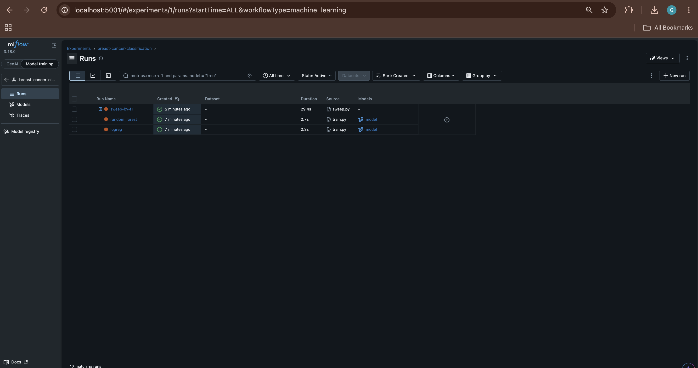
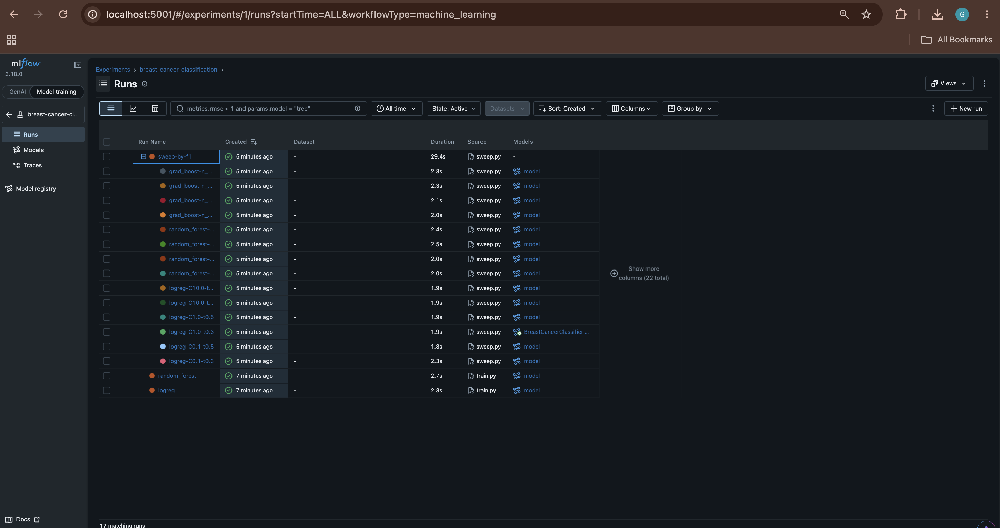
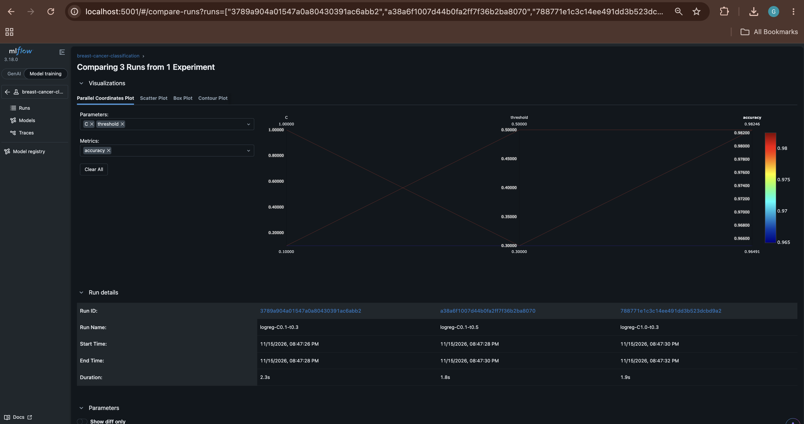
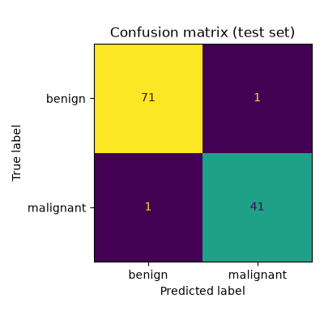
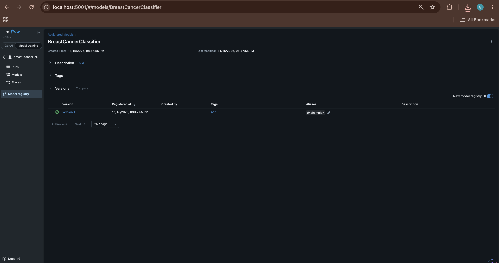

# MLOps Lab - MLflow Breast Cancer Classifier with Experiment Tracking & Model Registry

This lab is based on the course's MLflow Lab 1 and uses MLflow to track experiments, compare models, register the best model and serve it. Instead of the Wine Quality and diabetes datasets from the course lab, I used the Wisconsin Breast Cancer dataset, which has 30 measurements of cell nuclei per sample and two classes (malignant or benign). This turns the lab from a regression problem into a binary classification problem.

## Modifications from Original Lab

- **Dataset:** Wisconsin Breast Cancer (569 samples, 30 features) from `sklearn.datasets` instead of Wine Quality and diabetes. Nothing needs to be downloaded. Malignant is the positive class, since that is the case we most want to catch.
- **Problem type:** binary classification instead of regression.
- **Models:** three model types selectable from the command line (Logistic Regression, Random Forest, Gradient Boosting) instead of a single ElasticNet. Each is wrapped in a pipeline with a `StandardScaler`, so preprocessing is saved with the model.
- **Metrics:** accuracy, precision, recall, F1 and ROC-AUC instead of RMSE, MAE and R².
- **Decision threshold:** the probability cut-off for "malignant" is configurable and logged as a parameter. Lowering it catches more malignant cases at the cost of more false alarms.
- **Artifacts:** each run logs a confusion matrix and ROC curve plot in addition to the model.
- **Hyperparameter sweep:** `sweep.py` trains 14 candidates (7 model configurations × 2 thresholds) as nested child runs under one parent run, instead of launching single runs by hand.
- **Model Registry:** uses a SQLite backend so the registry works (the original lab skips registration with the default file store). The sweep registers the best model as `BreastCancerClassifier` and gives it the `@champion` alias.
- **Prediction:** `predict.py` loads `models:/BreastCancerClassifier@champion` from the registry and applies the threshold that model was selected with. The original `serving.py` only demonstrated how pip requirements are logged.
- **Tests:** a pytest suite in `tests/` (the original lab has none).
- **Structure:** a Python package (`lab/`) with separate modules instead of notebooks and standalone scripts.

### Issue found and fixed: MLflow 3.x and tree-based models

MLflow 3.x saves scikit-learn models with skops and reloads them to verify the save. skops refuses `sklearn.tree._tree.Tree`, the internal tree storage used by Random Forest and Gradient Boosting, unless it is explicitly trusted, so logging those models failed while Logistic Regression worked. Since the models are trained by this project's own code, `lab/train.py` trusts exactly that one type through `skops_trusted_types`, and only passes the argument on MLflow versions that support it. A parametrized test now logs and reloads every model type so this can't come back unnoticed.

## Project structure

```
├── docs/screenshots/      MLflow UI screenshots
├── lab/
│   ├── data.py            loads the dataset, stratified train/test split
│   ├── models.py          builds the three model types as sklearn pipelines
│   ├── metrics.py         metrics, threshold logic, confusion matrix and ROC plots
│   ├── tracking.py        MLflow setup (SQLite backend, experiment and model names)
│   ├── train.py           trains and logs a single run
│   ├── sweep.py           nested-run sweep, registers the best model as @champion
│   └── predict.py         loads the @champion model and makes predictions
├── tests/                 pytest suite
├── sample_request.json    example request body for the REST endpoint
├── requirements.txt
└── README.md
```

## Setup

Requires Python 3.10 or newer.

```bash
python3 -m venv .venv
source .venv/bin/activate
pip install -r requirements.txt
```

All commands below are run from the repo root with the virtual environment active.

## Start the MLflow UI

Run this in a separate terminal and leave it running:

```bash
mlflow ui --backend-store-uri sqlite:///mlflow.db --port 5001
```

Then open http://localhost:5001 and switch to **Model training** in the top-left toggle.

## Train single models

```bash
python -m lab.train --model logreg --C 1.0
python -m lab.train --model random_forest --n-estimators 300 --max-depth 8
python -m lab.train --model grad_boost --learning-rate 0.05 --threshold 0.3
```

Each run logs its parameters, the five metrics, the confusion matrix and ROC curve under `plots/`, and the model with its signature and an input example. Add `--register` to also register that model.

| Option | Applies to | What it does |
|---|---|---|
| `--model` | all | `logreg`, `random_forest` or `grad_boost` |
| `--C` | logreg | inverse regularization strength |
| `--n-estimators` | random_forest, grad_boost | number of trees |
| `--max-depth` | random_forest, grad_boost | maximum tree depth |
| `--learning-rate` | grad_boost | boosting learning rate |
| `--threshold` | all | probability cut-off for "malignant" (default 0.5) |
| `--register` | all | register the model in the Model Registry |

## Run the sweep and register the best model

```bash
python -m lab.sweep --metric f1        # or: recall, precision, accuracy, roc_auc
```

This trains all 14 candidates as child runs, picks the best by the chosen metric (ties broken by ROC-AUC), registers it and points the `@champion` alias at the new version.

## Predict with the champion model

```bash
python -m lab.predict --n 5
```

## Serve the champion model as a REST API

```bash
export MLFLOW_TRACKING_URI=sqlite:///mlflow.db
mlflow models serve -m "models:/BreastCancerClassifier@champion" -p 5002 --env-manager local
```

In another terminal:

```bash
curl -X POST http://127.0.0.1:5002/invocations \
     -H "Content-Type: application/json" \
     -d @sample_request.json
```

The REST endpoint uses the model's default 0.5 cut-off. `lab/predict.py` applies the tuned threshold.

## Screenshots

Experiment runs: the two single runs (`logreg`, `random_forest`) and the `sweep-by-f1` parent run



Sweep expanded: 14 nested child runs covering 7 model configurations × 2 thresholds, where `logreg-C1.0-t0.3` has the highest F1



Comparing runs side by side on the logged metrics



Logged artifacts: the confusion matrix for the winning run



Model Registry: `BreastCancerClassifier` version 1 with the `@champion` alias



## Tests

```bash
pytest -v     # run from the repo root
```

All 18 tests pass. They cover data loading and the stratified split, that every model type trains and beats the majority-class baseline, the metrics and threshold logic, that a run logs the expected parameters, metrics, plots and model, model registration, the sweep registering its best model as `@champion`, tie-breaking when picking the best run, and logging and reloading every model type. The MLflow tests use a temporary SQLite database, so they never touch the local `mlflow.db`.

## Results

Single runs on the test set (114 samples, threshold 0.5):

| Model | Accuracy | Precision | Recall | F1 | ROC-AUC |
|---|---|---|---|---|---|
| Logistic Regression (C=1.0) | 0.965 | 0.975 | 0.929 | 0.951 | 0.996 |
| Random Forest (300 trees, depth 8) | 0.965 | 1.000 | 0.905 | 0.950 | 0.994 |

Both models reach the same accuracy but make different mistakes. The Random Forest never flagged a benign sample as malignant (precision 1.0) but missed more malignant ones (lower recall). For a screening task, missed malignant cases are the costlier error, which is why the threshold is a tunable parameter and the sweep can select by recall.

### Sweep winner

The sweep (`python -m lab.sweep --metric f1`) compared all 14 candidates and selected **Logistic Regression with C=1.0 and a threshold of 0.3**, with **F1 = 0.976** and ROC-AUC = 0.996. It was registered as `BreastCancerClassifier` version 1 with the `@champion` alias.

This is the same model as the single Logistic Regression run above. Only the threshold changed, and lowering it from 0.5 to 0.3 raised F1 from 0.951 to 0.976. The ROC-AUC stays at 0.996 because it measures ranking across all thresholds; the gain comes purely from choosing a better cut-off. The simpler linear model also beat the Random Forest and Gradient Boosting configurations on this dataset.

Example output of `python -m lab.predict --n 5` with the champion model:

```
BreastCancerClassifier v1 (@champion), threshold=0.3
 row  p(malignant)  pred  actual
   0         0.000     0       0
   1         1.000     1       1
   2         0.043     0       0
   3         0.576     1       1
   4         0.509     1       0
```

Four of the five rows are correct. Row 4 is a benign sample the model was unsure about (probability 0.509), so it was flagged as malignant: a false alarm, which is the kind of error a lower threshold accepts in exchange for missing fewer malignant cases.
